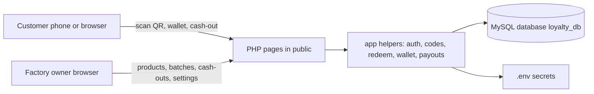
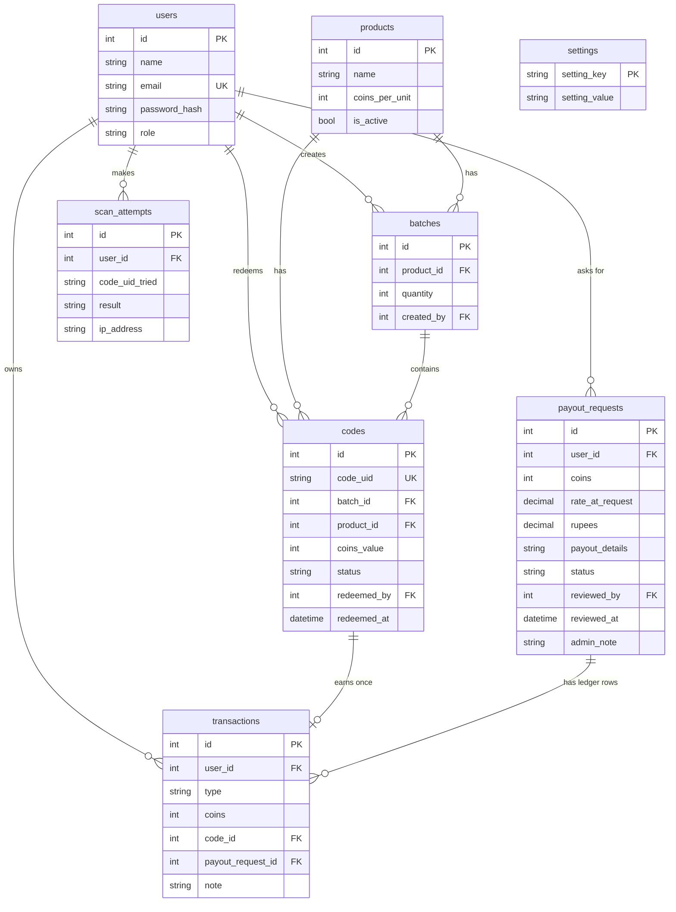
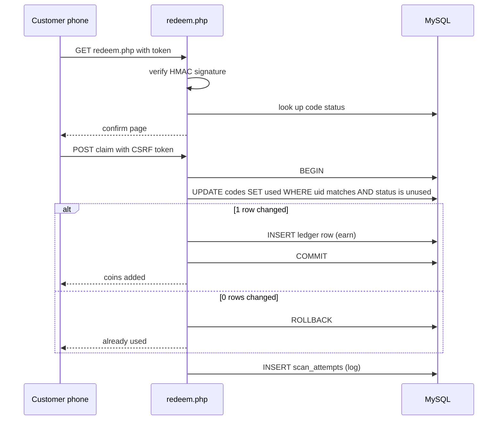
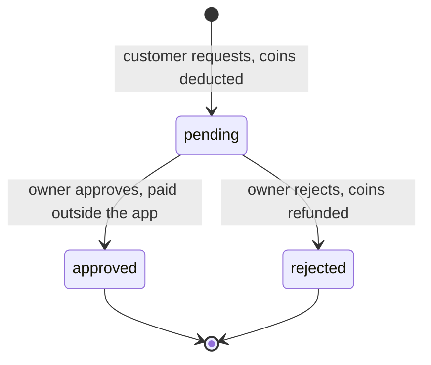

## 1. Overview

The factory prints a unique QR code for every product box. A customer scans the code, logs in, and
claims coins. Coins are recorded in a ledger and can be cashed out to rupees after the factory owner
approves the request. The owner manages products, code batches, the coin rate and cash-out requests
from an admin area.



## 2. Stack choice and reasons

| Layer | Choice | Why |
|---|---|---|
| Language | PHP 8 (plain, no framework) | I am learning web development; plain PHP shows every mechanism (sessions, queries, forms) without framework magic, and I can explain each line. |
| Database | MySQL (InnoDB) | The reward logic needs transactions, row locks and foreign keys. InnoDB provides all three. |
| DB access | PDO with prepared statements | Blocks SQL injection and gives clean error handling and transactions. |
| UI | HTML, Bootstrap 5 (CDN) | Fast, responsive layout that works on a phone, which is where customers scan QR codes. |
| QR images | qrcode.js (CDN), drawn in the browser | Avoids Composer and server-side image libraries, so setup stays simple. Trade-off: the print sheet needs internet access. |
| Code signing | HMAC-SHA256 (built into PHP) | Lets the server reject invented codes without a database lookup. |
| Local environment | XAMPP (Apache, MySQL, phpMyAdmin) | Easy to install and run on Windows. |
| Secrets | `.env` file, excluded from Git | Keeps keys and passwords out of the repository; `.env.example` shows the variables. |

Alternatives considered and not chosen:
- **Laravel or Node.js**: more setup and hidden behaviour; the project is about understanding the logic.
- **A PHP QR library via Composer**: extra install step for a beginner setup; revisit for production.
- **Storing a balance column**: can drift out of sync; a ledger cannot (see section 4).

## 3. Project structure

```
loyalty-rewards/
  app/                 PHP logic (no pages)
    config.php         loads .env, url() helper
    db.php             PDO connection
    auth.php           sessions, login checks, CSRF, escaping
    header.php / footer.php   shared page layout
    settings.php       read and write owner settings
    codes.php          code generation, HMAC signing and verification
    redeem.php         atomic redemption, ledger insert, scan log, rate limit
    wallet.php         history, pagination, summary
    payouts.php        cash-out requests, approve, reject
  public/              pages the browser opens
    register.php  login.php  logout.php  index.php (wallet)  redeem.php  payout.php
    admin/             index.php  products.php  batches.php  batch.php  payouts.php  settings.php
  database/            schema.sql  002_payouts.sql  demo_data.sql  demo_reset.sql
  tests/               test_codes.php  test_redeem.php  test_wallet.php  test_payouts.php  MANUAL_TESTS.md
  README.md  ASSUMPTIONS.md  AI_LOG.md  ARCHITECTURE.md  .env.example
```

## 4. Data model



What each table is for:

| Table | Purpose |
|---|---|
| `users` | Customers and the owner (`role` column). Passwords stored as hashes. |
| `products` | What the factory sells and how many coins one box earns. Deactivated, never deleted. |
| `batches` | One generation run of codes for one product. |
| `codes` | One row per physical box. Holds its own copy of the coin value, and who redeemed it and when. |
| `transactions` | The coin ledger. Positive = earned or refunded, negative = cashed out. |
| `payout_requests` | Cash-out requests, with the rate and rupee amount locked at request time. |
| `scan_attempts` | Every scan, successful or not, with IP address, for fraud monitoring. |
| `settings` | Owner-editable values: coin-to-rupee rate and minimum cash-out. |

Design decisions:
- **No stored balance.** A customer's balance is the sum of their ledger rows, so the balance and the history can never disagree. Rows are never edited or deleted; a correction is a new row.
- **The coin value is copied onto each code** when the batch is generated. Printed boxes cannot change, so changing a product's coins later affects only future batches.
- **The rupee amount is locked into the cash-out request**, so a later rate change cannot change what the owner has to pay.

Rules enforced by the database itself (so a bug in PHP cannot break them):
- `codes.code_uid` is unique: no two boxes share a code.
- `transactions.code_id` is unique: a code can earn coins only once.
- `transactions (payout_request_id, type)` is unique: a cash-out request has at most one deduction row and one refund row, so a double refund is impossible.
- Foreign keys keep every batch, code, ledger row and request tied to a real product and user.

## 5. Code design and QR generation

- **uid:** 12 random characters from a 32-character alphabet (no `0, O, 1, I`), generated with `random_int()`, unique in the database.
- **Token printed in the QR:** `uid-signature`, where the signature is the first 10 hex characters of HMAC-SHA256(uid, `QR_SECRET_KEY`). Invented or altered codes are rejected before any database query.
- **The database is still the authority** on whether a code has been used (atomic UPDATE, section 6).
- **QR link:** the QR holds a full link built from `APP_URL` (`.../redeem.php?c=TOKEN`). The production domain must be set before the real print run.
- **QR images** are drawn in the browser with qrcode.js. Trade-off: the print sheet needs internet access.
- **Batch creation** runs in a transaction: a batch and all of its codes are saved together or not at all (limit: 500 codes per batch).

## 6. Redemption flow (proof of purchase and reuse prevention)

Proof of purchase: the QR code is placed inside the box, so it can only be seen after the product is bought and opened.



Key points:
- Scanning (GET) only shows information. Coins are given only on the button press (POST), so link previews and scanners cannot burn a code.
- The one-time rule is a single atomic `UPDATE ... WHERE status='unused'`. Only one caller can ever change a code from unused to used, even if two people press the button at the same instant.
- The status change and the ledger row are in one transaction: both happen or neither does.
- Failed attempts are logged after the transaction ends, so a rollback cannot erase the log of the attempt.
- Rate limiting: 10 failed scans in 15 minutes (per account or per IP address) locks scanning temporarily.

## 7. Cash-out flow



Rules:
- **Coins leave the wallet at request time** (a negative ledger row), so the same coins cannot be requested twice. A rejection adds a positive refund row; nothing is edited.
- **No overdraw:** the customer's row is locked (`SELECT ... FOR UPDATE`) while a request is created, so two simultaneous requests are processed one after the other and the second sees the reduced balance.
- **One decision only:** approve and reject are `UPDATE ... WHERE status='pending'`; if another decision already happened, 0 rows change and nothing is done.
- **No double refund:** the unique key on `(payout_request_id, type)` refuses a second refund row.
- **Rate lock:** the rupee amount is calculated when the request is made, in whole paise (integer arithmetic) to avoid floating-point errors.
- **Payment is manual:** the owner pays the customer outside the system (for example by UPI) and then presses Approve. One pending request per customer, and a minimum cash-out set by the owner.

## 8. Fraud prevention summary

| Threat | Defence |
|---|---|
| Inventing codes | Random 12-character uid plus HMAC signature; checked before the database |
| Guessing codes | Random uid space of about 1.15 x 10^18, signature, rate limit by account and IP, all attempts logged |
| Reusing a code | Atomic UPDATE in a transaction; UNIQUE ledger key as a last safety net |
| Two people claiming at once | Row lock taken by the UPDATE; only one succeeds |
| Photographing a code in a shop | Code placed inside the box (assumption A3) |
| Link previews redeeming a code | Redeem needs a POST with a CSRF token |
| Overdrawing coins | Customer row locked while a cash-out request is created |
| Double payout or double refund | Atomic status change plus UNIQUE `(payout_request_id, type)` |
| Taking over an admin account | Public registration creates customers only; admin pages call `require_admin()` |
| Blocking a stolen or faulty batch | Owner or database can mark a code `blocked`; blocked codes cannot be redeemed |

## 9. Owner monitoring

The owner can currently:
- see product, customer and pending cash-out counts and the coin rate on the admin dashboard;
- see, for each batch, how many codes were generated and how many were used;
- review, approve or reject cash-out requests, with notes and a history;
- change the coin rate and minimum cash-out.

Every scan attempt (success, invalid, already used, blocked) is stored in `scan_attempts` with the account and IP address, ready for the monitoring dashboard.

<!-- TODO: after the monitoring dashboard (Step 9) is built, describe its charts and fraud flags here. -->

## 10. Security measures

- **Passwords:** `password_hash` / `password_verify` (bcrypt); never stored in plain text.
- **SQL injection:** every query uses PDO prepared statements.
- **XSS:** all output passes through `htmlspecialchars` (the `e()` helper).
- **CSRF:** every state-changing form carries a per-session token.
- **Sessions:** the session ID is regenerated at login.
- **Authorization:** `require_login()` / `require_admin()` at the top of every protected page; the user ID always comes from the session, never from the URL.
- **Fake codes and reuse:** see sections 5, 6 and 8.
- **Money:** row locks, atomic status changes, integer (paise) arithmetic and database unique keys (section 7).
- **Secrets:** kept in `.env`, which is excluded from Git; `.env.example` contains placeholders only.

## 11. Testing

- **Automated** (run from the project folder with `C:\xampp\php\php.exe tests\<file>`):
  `test_codes.php` (code generation and signatures), `test_redeem.php` (one-time redemption, rate limit, database safety net),
  `test_wallet.php` (history, pagination, isolation between users), `test_payouts.php` (cash-out, approve, reject, refunds).
  The database tests create temporary rows and delete them afterwards.


